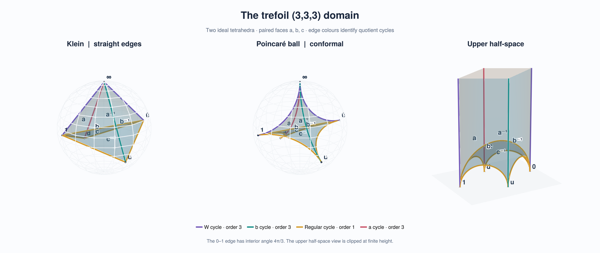
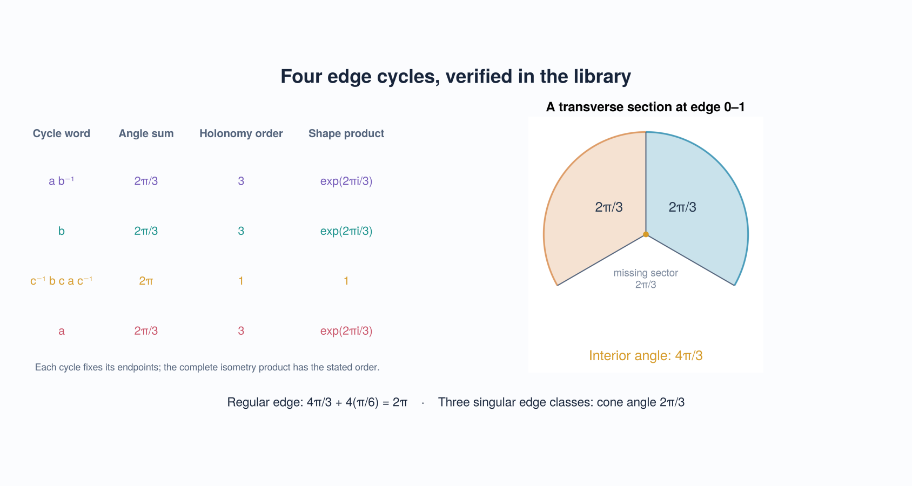

# Trefoil (3,3,3): two tetrahedra and their edge equations

The fixture reproduces the (3,3,3) case of
[Compute Face Pairings](https://chatgpt.com/share/6ae1939a-e5a0-83ec-ad4b-cfb285e755f4).
The locally saved construction is
`/home/tcsiz/Projects/phd-notes/ideas/20261027000500.md`; its rational dissection
certificate is the source of the existing fundamental-domain claim. This work
independently recomputes the geometry and local gluing equations in Kleinian.
The proposed (3,3,4) hyperideal deformation in the chat is outside this example.

Put ω=exp(2πi/3), u=(2+ω)/3, d=(1−ω)/3. The displayed region is the union

```text
T+ = [∞,0,1,u],    T− = [∞,0,1,d].
```

The shared face [∞,0,1] carries the identity gluing. Each tetrahedron has
opposite-edge angle types (2π/3,π/6,π/6). Their union is nonconvex at 0–1:
the two 2π/3 sectors give a genuine interior angle of 4π/3.

The three exterior maps, written in the source's complex coordinate z=x+iy,
are

```text
a = [-1-ω  1+ω]    b = [-ω    ω ]    c = [ -1     1  ]
    [  0     ω ]        [ 0   1+ω]        [ω-2   1-ω ]
```

| Map | Source ordered face | Target ordered face |
| --- | --- | --- |
| a | (1,d,∞) | (0,d,∞) |
| b | (1,∞,u) | (0,∞,u) |
| c | (0,1,d) | (u,0,1) |

Kleinian's documented matrix spinor coordinate is ζ=x−iy. The fixture
therefore conjugates the displayed matrices once when creating
`MobiusIsometry` objects. Vertex coordinates continue to use the ordinary
upper-half-space convention (x,y,height). The constructor verifies every
face correspondence and the interior-to-exterior side condition.

## Results computed by the API

The directed edge walk finds the following circuits. The first and third
words are inverses of the corresponding source-chat relators; the circuit
direction does not change their equations.

| Cycle word | Physical edges | Angle sum | Holonomy order | Shape product |
| --- | --- | --- | --- | --- |
| a b⁻¹ | ∞–0, ∞–1 | 2π/3 | 3 | ω |
| b | ∞–u | 2π/3 | 3 | ω |
| c⁻¹ b c a c⁻¹ | 0–1, 0–u, 1–u, 0–d, 1–d | 2π | 1 | 1 |
| a | ∞–d | 2π/3 | 3 | ω |

There are twelve tetrahedral edge sectors and nine physical edges. The
regular cycle sums to 4π/3+4(π/6)=2π. Thus the reflex edge belongs to a
regular quotient-edge class; it is not itself an order-three singular axis.

The exact test checks all endpoint equations, the minimal holonomy orders,
and the complex shape products over Nemo's algebraic numbers. It also checks
the source relations directly:

```text
a³ = b³ = (b a⁻¹)³ = 1,
c a⁻¹ c⁻¹ b⁻¹ c = 1.
```

With f=c a⁻¹ and g=a, the library verifies b=f g f g⁻¹ f⁻¹ and c=f g,
as well as f³=g³=(f g f g⁻¹ f⁻¹ g⁻¹)³=1. These verify relations of the
constructed matrices; they do not by themselves prove abstract faithfulness.

## Run the computations

```julia
using Kleinian, Poincare
include("examples/trefoil333_data.jl")
data = trefoil333()
report = verify_edge_gluings(data.domain; atol=1e-10)
@assert report.valid
report.edge_cycles
```

For exact algebraic verification, use an environment with Nemo 0.56:

```julia
using Kleinian, Poincare, Nemo
include("examples/trefoil333_data.jl")
K = algebraic_closure(QQ)
data = trefoil333(root3=sqrt(K(3)))
report = verify_edge_gluings(data.domain; atol=0)
@assert report.valid
@assert all(isidentity, data.relations)
```

The example `examples/verify_trefoil333.jl` prints the numerical report.
Run the independent exact suite from the repository root with:

```sh
julia experiments/setup.jl
julia --project=experiments test/trefoil_exact.jl
```

## Visualisations





```julia
using GLMakie, Kleinian
include("examples/trefoil333.jl")
display(trefoil333_models())
display(trefoil333_edge_figure())
view = trefoil333_explorer()
display(view.figure)           # native Makie camera and model-selection menu
save("trefoil-models.png", trefoil333_models())
```

For static output, use CairoMakie instead. GLMakie provides smoother
transparency for overlapping three-dimensional faces. Both use the same
GeometryBasics meshes and the same verified geometry.

The plots apply (z,h)↦(2z−1,2h), conjugating all face maps along with the
vertices. This centers the reflex edge as a ball diameter, making its
conformal transverse angle easy to inspect. The half-space chart is clipped
at finite height; the ideal endpoint ∞ is not a finite plotted point.
