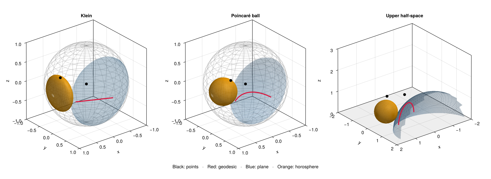

# Hyperbolic models and Makie plots

Kleinian adapts its geometry to [Makie](https://docs.makie.org/stable/)
plots and [GeometryBasics primitives and tessellations](https://juliageometry.github.io/GeometryBasics.jl/stable/primitives/).
Makie handles rendering, cameras, styling, layouts, and image export.
The plotting extension loads automatically with any Makie backend. The
geometry and model conversion code does not import a rendering backend.

[Polygons and tetrahedral domains](polyhedra.md) use the same plotting API.
The [(3,3,3) trefoil example](trefoil333.md) includes an interactive model
selector, coloured edge classes, paired-face labels and exact gluing checks.

Install a backend in your working environment: `import Pkg; Pkg.add("GLMakie")`
for interactive plots, or `Pkg.add("CairoMakie")` for static output. Supported
versions are Makie 0.24 and GeometryBasics 0.5 (CairoMakie 0.15).

```julia
using Kleinian, Poincare, GLMakie

p = HyperbolicPoint(1,0,0,0)
q = HyperbolicPoint(5,1,2,3)
g = Geodesic(p,q)
plane = HyperbolicPlane(clvector(0,0,1,0))
h = Horosphere(clvector(2,2,0,0))

view = hyperbolicplot(g; model=:ball, color=:crimson, linewidth=3,
                      axis=(title="Hyperbolic geometry",))
hyperbolicplot!(view.axis,[p,q]; model=:ball, color=:black, markersize=12)
hyperbolicplot!(view.axis,plane; model=:ball, color=(:steelblue,0.25))
hyperbolicplot!(view.axis,h; model=:ball, color=(:orange,0.4))
display(view.figure)
save("hyperbolic-ball.png",view.figure)
```

For CairoMakie, replace `using GLMakie` with `using CairoMakie`. GLMakie uses
Makie's usual Axis3 mouse controls; no custom viewer or renderer is involved.
Each call returns a normal Makie plot handle, supporting its normal attributes.
Vectors of points render together in one scatter plot, including per-point
colors and marker sizes through Makie keywords. Mixed vectors of objects
return a vector of handles.
For an existing `Axis3` or `LScene`, use `hyperbolicplot!` directly. Keep all
objects on the same axis in the same model. Use separate axes to compare charts.

## Coordinates and chart conventions

All three models describe H³. The upper half-space model is the 3D analogue
of the upper half-plane. Its third coordinate is height; points with second
coordinate zero give the usual upper half-plane slice.

For a future unit Lorentz vector `(t,x,y,z)`:

| Model keyword | Model coordinates | Ideal boundary |
| --- | --- | --- |
| `:klein` | `(x,y,z)/t` | unit sphere |
| `:ball` | `(x,y,z)/(t+1)` | unit sphere |
| `:halfspace` | `(x,y,1)/(t-z)` | height-zero plane plus infinity |

`modelcoordinates(p; model=:ball)` also accepts unnormalized projective
representatives, preserves BigFloat precision, and does not change the object.
`modelpoint(c; model=...)` converts back to a finite `HyperbolicPoint`.
`modelidealpoint(c; model=...)` converts boundary coordinates to an `IdealPoint`.

For ideal points the ball and Klein coordinates coincide; in half-space they
have height zero. The ideal direction `IdealPoint(1,0,0,1)` is chart infinity.
Converting or plotting it in half-space throws `DomainError`; it has no finite
Euclidean position. Plot other ideal points normally with `hyperbolicplot!`.

## Geometry adapters

`plotgeometry(object; model=:ball, resolution=64, cutoff=1e-3)` returns:

| Object | GeometryBasics result | Makie primitive |
| --- | --- | --- |
| finite or ideal point | `Point3d` | `scatter!` |
| geodesic | vector of `Point3d` samples | `lines!` |
| hyperbolic plane | triangle `Mesh` | `mesh!` |
| horosphere | triangle `Mesh` | `mesh!` |

These are standard GeometryBasics data; pass them to Makie yourself for
wireframes, custom materials, or integration with an existing plotting workflow.
Plane meshes map a GeometryBasics tessellated rectangle into a Klein disk,
then change chart. Horospheres begin with GeometryBasics spheres in the
Poincaré ball. The horosphere defined by `h=(a,a*n)` has Euclidean ball center
`a*n/(a+1)` and radius `1/(a+1)`. Its scale therefore remains significant.

Geodesics draw the full axis, even when constructed from two finite points.
`resolution` controls line sampling and surface tessellation. Infinite geometry
needs truncation: `cutoff` shortens each end of a Klein chord and shrinks the
radius of a Klein plane disk by that fraction. Horosphere faces are retained
only when all vertices have ball radius less than `1-cutoff`; this removes a
cap near the ideal tangency. Reduce `cutoff` to show more of the object and
increase `resolution` to resolve curvature. Triangle interiors approximate the
surface; only their vertices satisfy the exact surface equation.

Rendering converts coefficients to Float64. Features near the boundary may
require a different chart, cutoff, or resolution. The half-space chart can
produce very large finite coordinates near infinity; use Makie's `limits!`
or clipping facilities to choose the visible region. `modelboundary!` draws
the unit sphere using Makie wireframe, or a finite height-zero square using
GeometryBasics and Makie mesh. Its half-space `extent=3` is configurable.

## Comparison example and testing

From the repository root, with a backend installed:

```julia
using CairoMakie  # or GLMakie
include("examples/visualizations.jl")
fig = visualization_comparison()
display(fig)
save("hyperbolic-models.png",fig)
```

This shows the same points, geodesic, plane, and horosphere in all three models.



Coordinate conversion tests run with the ordinary suite. The optional plotting
suite checks transformed vertices against Lorentzian incidence equations and
renders all three models with CairoMakie:

```sh
julia experiments/setup.jl
julia --project=experiments test/makie.jl
```
