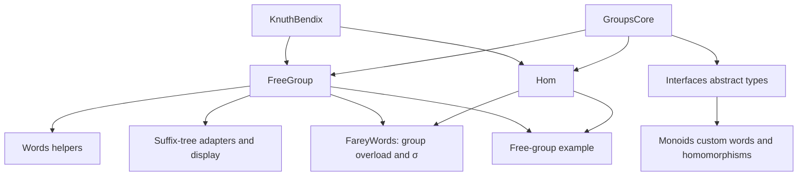

# Cleanup tracker: consolidate on Monoids

Prepared 2026-10-12. This is the working migration document; implementation
changes have not started. Source line references describe the initial snapshot
and may shift during cleanup.

## Agreed direction

- `FreeGroup.jl` is outdated. The implementation loaded by `Monoids.jl`
  (`MonoidWords.jl`, `CyclicWords.jl`, `MonoidHoms.jl`) is the preferred foundation.
- Migrate the functionality that depends on the old FreeGroup implementation
  to the Monoids implementation, then retire the old code.
- Remove package dependencies on **KnuthBendix** and **GroupsCore** (the latter
  is the package listed in `Project.toml`, referred to as GroupCore in discussion).
- Preserve the mathematical operations needed by continued fractions,
  Christoffel/Farey words, S-sequences, homomorphisms and suffix trees.
- Keep the shared algebra interface and most generic operations in
  `GroupInterface.jl`. Monoids owns concrete generators, words and substitution;
  the interface supplies dependency-independent defaults.
- Use `../farey-testing/working_setup.jl` as a primary source of actual research
  workflows and migration requirements. It currently mixes both representations.

“Migrate dependencies to Monoids” means redirect dependent code to the custom
word implementation; it does not mean moving the external package imports
into that module. Physical placement of higher-level algorithms can remain
separate from ownership of the algebra types.

## Current dependency paths

Arrows show dependencies from a provider to its consumers. In particular,
Monoids has an **indirect GroupsCore dependency through Interfaces**, despite
having no direct GroupsCore API calls in its word arithmetic.

## KnuthBendix usage inventory

| Location | Current use | Migration action |
| --- | --- | --- |
| `Project.toml:12,25` | Dependency and compatibility entries | Remove both after migration and clean-environment validation |
| `src/Farey.jl:3–4,37` | Imports `KB`, `MON = KnuthBendix.FPMonoids`; exports both aliases | Remove imports and exports; document removal of qualified external APIs |
| `src/FreeGroup.jl:2–16` | Stores `KB.Alphabet`, `KB.Words.Word{UInt}`; accepts `KB.Words.AbstractWord`; reduces through `MON.normalform!` | Replace consumers with FreeGen/MonoidWord; use custom multiplication/reduction, not a rewriting-system wrapper |
| `src/FreeGroup.jl:21,51–53` | Word conversion and `KB.inv` with an alphabet | Use custom constructors and `inv`; compare generator/inverse conventions explicitly |
| `src/FreeGroup.jl:68–86` | `KB.Alphabet`, `setinverse!`, `Word`, `inv`, `RewritingSystem`, `LenLex`, `MON.FPMonoid` | Retire old group construction; replace examples with explicit custom generators |
| `src/FreeGroup.jl:99–130` | Display ultimately renders the backing FPMonoid | Replace needed display uses with Monoids display / `prettyrepr` |
| `src/Homomorphisms.jl:5–22` | Image dictionary stores `KB.Words.AbstractWord`; constructs inverse-letter images from parent groups | Migrate substitution to `Monoids.MonoidHom`; determine required validation and inverse-image behavior |
| `src/Farey.jl:23` | Commented `KB.inv` / GroupsCore element method | Remove obsolete commented adapter with the legacy implementation |

The active direct KnuthBendix API uses are confined to the root imports,
FreeGroup and Hom. Other files consume their types or behavior indirectly.
No direct uses were found in continued fractions, custom word arithmetic,
tests or the continued-fraction example.

## GroupsCore usage inventory

| Location | Current use | Migration action |
| --- | --- | --- |
| `Project.toml:10,23` | Dependency and compatibility entries | Remove both once no external types or methods remain |
| `src/Farey.jl:5,37` | Imports/exports `GPC` | Remove alias and update the example/API documentation |
| `src/GroupInterface.jl:2–7` | `AbstractElement <: GPC.GroupElement`, `AbstractMonoid <: GPC.Monoid`; local group/monoid element hierarchy | Make retained abstract types locally owned, without external supertypes; retire unused legacy group branches |
| `src/FreeGroup.jl:4,6,11,23` | `GPC.Monoid` and `GPC.MonoidElement` fields, constructor signatures and conversions | Retire these along with the old FreeGroup wrapper |
| `src/FreeGroup.jl:34–38` | Extends `GPC.isfinite`, `GPC.gens`, `GPC.parent` | Remove old extensions; use explicit generator selection and custom word operations; add local APIs only if needed |
| `src/FreeGroup.jl:99–105` | `GPC.gens` for group display | Use retained custom representation display |
| `src/Homomorphisms.jl:19,53,65` | Enumerates generators for map validation, identity homomorphism and display | Use explicit map keys/generator sets; settle identity and strictness contracts |
| `examples/free_group_ex.jl:8–10` | `GPC.gens` obtains generators and their inverses | Construct Monoids generators directly and use `inv` |

Indirect consumers of the Interfaces hierarchy include root operators,
MonoidWords, MonoidHoms, Words, FareyWords and SuffixTrees. Merely removing
`import GroupsCore` will break abstract type declarations at package load time.

`AbstractHom` is already local and has no GroupsCore supertype.
`Monoids.jl` imports `AbstractMonoid` but only mentions it in a commented
FreeMonoid declaration. No concrete custom parent monoid currently implements
the callable `G.(1:2)` convention used by the Christoffel group overload.

### Implicit GroupsCore defaults and proposed interface ownership

Removing the external supertypes also removes inherited methods, including
methods not mentioned by name in this repository. The installed GroupsCore
0.5.2 `src/elements.jl` was inspected to inventory these defaults.

| Operation | Current provider / behavior | Cleanup requirement |
| --- | --- | --- |
| Element conjugation `x^y` | GroupsCore supplies same-type conjugation via `conj`; Farey already defines a more specific local AbstractElement method `inv(y)*x*y` in `Farey.jl:33` | Move the local convention to GroupInterface; verify both same-type and mixed generator/word operands |
| Two-argument `conj(x,y)` | Inherited GroupsCore implementation uses `similar` and `conj!` | Provide a local nonmutating default if retained as public interface |
| Right division `/` | GroupsCore default uses `similar` and `div_right!`; Farey already defines local `x*inv(y)` | Move local `/` and left division `inv(x)*y` to GroupInterface, with explicit operand ordering |
| Unary minus and `↑` | Already implemented in Farey; minus inverts and calls Monoids.expand!, while `x ↑ y = x^inv(y)` | Centralize conventions; keep concrete expansion in Monoids or expose a small interface hook to avoid an interface-to-Monoids loading cycle |
| Literal inverse `x^-1` | GroupsCore defines `Base.literal_pow` for GroupElement, returning `inv(x)` | Preserve this behavior locally and test literal and variable integer exponents separately |
| General integer powers | GroupsCore fallback handles negative powers and calls power-by-squaring | Add only the needed local fallback; custom FreeGen, MonoidWord and CyclicGen already specialize integer powers |
| `similar`, `isone` | Inherited defaults return `one(x)` and compare with `one(x)` | Supply local defaults where required; no parent object is needed |
| `copy` | GroupsCore defaults to deepcopy | Decide independent-copy semantics, especially for mutable words; test that transformations do not unexpectedly alter dictionary keys or source words |
| `hash(x,h)` | GroupsCore hashes the concrete type and each field | Define hashing consistent with mathematical equality, particularly compressed/powered words; field hashing is not automatically correct for alternate equal representations |
| `one(x)`, `parent(x)` | GroupsCore default identity delegates to parent; missing parent throws an interface exception | Custom types already implement identities. Avoid a parent-based default for words without parents |
| Equality, multiplication and inverse | GroupsCore supplies interface-error fallbacks; custom types provide concrete methods | State these as required primitives; do not retain external exception dependencies |
| Commutators and mutable helpers | GroupsCore supplies commutator, mul!, inv!, one!, division and conjugation helpers | Implement only needed local APIs; decide conventions before exposing commutators, and preserve documented aliasing semantics if mutable APIs are retained |
| Order/finiteness and parent-monoid APIs | GroupsCore supplies order iteration, group iteration/generator access and related fallbacks | Audit retained external workflows before adding replacements; do not copy the whole package interface |

Base also supplies defaults such as `isequal` through equality; those are
distinct from GroupsCore-provided methods. Verify dispatch after detaching the
hierarchy rather than assuming every currently available method is inherited
from GroupsCore.

Runtime dispatch checks on a custom FreeGen confirmed that `^` conjugation
and `/` currently select Farey's local methods, while `hash`, `copy`,
`similar`, `isone` and literal inverse powers select GroupsCore methods.
Type-level `one` selects Monoids and `isequal` selects Base. Thus conjugation
already has a local definition, but the implicit dependency is substantial.

Target loading arrangement: GroupInterface defines local abstract types and
generic algebra contracts first; Monoids implements concrete primitives and
word-specific behavior next; Farey imports/re-exports them and loads the
mathematical algorithms. Preserve specialized word operations in their own
files rather than forcing all implementation into GroupInterface.

### External research workflow inventory

Inspected `../farey-testing/working_setup.jl` directly and searched sibling
Julia scripts for related usage. This is read-only research context, not code
being modified in this cleanup. Line references below are to that setup file.

| Lines / functions | Observed workflow | Migration requirement |
| --- | --- | --- |
| 5–10, 75–76 | Initializes legacy groups and uppercase inverse bindings, then replaces `f,g` and `a,b` with custom FreeGen values | Make setup consistently custom; regenerate inverse bindings when generators change, rather than mixing old `F,G,A,B` with new lowercase generators |
| 18–35: callable FreeGroupElement | Evaluates words as strings or substitutes arbitrary AbstractElement images; explicitly constructs inverse images | Preserve generic word evaluation, including target identities and string inverse-display policy; this is broader than a same-type MonoidHom |
| 38–47; 522–536: callable MonoidWord, mateval, monoideval | Dictionary-based evaluation into matrices or other monoids; custom inverse function `IFUNC=inv2`; explicit initializer in monoideval | Provide or document generic evaluation with configurable inversion and target identity; include empty words, single generators and missing keys |
| 72–94: Ω, Fw, Ψ, Wr, Ψa, Λ, χ | Christoffel/Farey words evaluated in PillowGroup; accesses legacy `.elem` and uses both left and right division | Replace backing-element access with explicit evaluation/adapters; preserve target-group support rather than restricting all outputs to custom words |
| 114–137: rileyw, long_n, rev_conj | Constructs signed alternating words from rational slopes and modular arithmetic | Useful independent research examples and expected-word fixtures for powers/inverses and rational conventions |
| 139–238: signs_dec, signs_seq, ab, reverse | Legacy parent-based letter inspection coexists with custom letter iteration and generator-keyed dictionaries | Prefer eachgen; define signed-letter convention locally. `ispositive` is called but no definition was found in library/setup source; ab accepts `ggs` but reads global `ab_gens` |
| 279–328: palindrome helpers | Reversal, palindromic suffixes, common prefixes/suffixes, parent-based Pal and pal_conj | Review these before removing unloaded palindrome experiments: there is demonstrated external use of related functionality |
| 339–438: FareyDecomp! | Rational-neighbour decomposition, word slices, inverse words and styled explanation | Extract mathematical computations and known identities for regression tests; keep presentation optional |
| 454–488: commu, farey_expr, expandhom | Element conjugation such as `w1^f`, conjugation by `-f`, powers, partial substitution and generated symbolic names `W0`, `W1`, etc. | High-priority tests for interface operators and MonoidHom; preserve leaving unmapped symbolic generators unchanged where intended |
| 250–277; 491–520 | Möbius/matrix helpers and styled printing | Treat as application helpers initially; do not introduce plotting, matrix algebra or presentation dependencies into the core interface |

`commu(f,g) = f/(f^-g)` expands using current conventions to
`f*g*inv(f)*inv(g)`. GroupsCore's commutator is `inv(f)*inv(g)*f*g`.
These differ: establish the intended public convention rather than silently
replacing the research helper with GroupsCore's definition.

The setup includes `../Farey/working/PillowGroup.jl` and `autF2.jl`; those paths
are absent in this checkout. Their implementations and required interfaces
remain to be inspected. The setup was not executed: it has external includes
and top-level research state. Its mixed use of `.elem`, parent groups and
custom generators is evidence for migration requirements, not a verified
end-to-end baseline.

Other sibling scripts contain concrete old and new consumers, including
`working.jl`, `tree_builder.jl`, `sl2algebra.jl`, `BirmanJacobian.jl`,
`hall_words.jl` and `field_calc_hecke.jl`. They provide additional compatibility
fixtures; this inspection is not a full audit or migration of that repository.

## Consumers to migrate

| Consumer | Existing dependency / assumption | Target and acceptance check |
| --- | --- | --- |
| `src/Farey.jl:9,25–49` | Root owns Interfaces imports and shared arithmetic; includes/exports FreeGroup, Hom and pretty_rep | Keep useful operators working with custom elements; remove legacy includes/exports after consumers migrate |
| `src/MonoidWords.jl:1`; `src/MonoidHoms.jl:1–2` | Imports abstract types from Interfaces/root; MonoidHoms also broadly imports Farey while Farey is loading Monoids | Prefer explicit relative imports; make type/operator ownership and include order clear, avoiding reliance on partial root initialization |
| `src/Words.jl:4–7,11–26` | FreeGroup word/parent adapters; `<<` reads `x.parent`; old conj_prefix builds words through a group | Retain custom `conj_prefix`; implement shifts via custom iteration/indexing and identity, including empty words and negative shifts. `parent(custom word)` currently returns an iterator, not a group: do not preserve that as a group abstraction |
| `src/FareyWords.jl:4,42` | Main Christoffel algorithm uses AbstractElement arithmetic; convenience overload accepts callable AbstractMonoid | Retain generator-pair API; retire or deliberately replace parent-object convenience overload; verify zero and signed inputs |
| `src/FareyWords.jl:67–102` | S-sequences already use custom FreeGen; Farey words use arithmetic and slicing | Validate these as the main retained path; no KB backend should be needed |
| `src/FareyWords.jl:105–110` | `σ` accepts FreeGroup objects and constructs Hom | Express required generator substitution with MonoidHom, or explicitly retire if unused; verify its two images |
| `src/SuffixTrees.jl:7,173–179` | FreeGroupElement import and text adapters | Remove legacy adapters; retain custom generator encoding and string support |
| `src/SuffixTrees.jl:171,181–195,750–825` | Generic element path uses `word`; custom encoding uses eachgen/id; reprtree assumes `.parent`, callable group and backing `.word` | Audit explicit imports and replace group-dependent display with custom word slicing/display; test tree construction and each retained renderer separately |
| `src/Palindromes.jl:35` | Unloaded module still has a FreeGroupElement method; commented legacy code also exists | Remove or migrate the method if preserving experiments; keep module unloaded until its unfinished code is resolved |
| `examples/free_group_ex.jl` | Uses FreeGroup, GPC.gens, Hom and group-word functions | Rewrite around FreeGen/FreeWord/MonoidHom; include all retained mathematical examples |
| README and earlier inventory | Present FreeGroup/Hom as primary implementation | Update to Monoids-first guidance and link migration examples |

## Behavior that needs an explicit migration decision

| Topic | Difference / uncertainty | Working direction |
| --- | --- | --- |
| Generator identity | Old groups have alphabets and named inverse symbols; custom FreeGen uses numeric IDs, exponents and an inverse flag | Use Monoids IDs/inverses; do not infer that uppercase custom names are inverses: the parser assigns uppercase letters distinct IDs |
| Parent/domain identity | FreeGroup elements have group parents; custom words do not | Use explicit generator maps. Add a local domain abstraction only if real retained use cases require one |
| Homomorphism validation | Hom requires a full generator map; MonoidHom defaults to leaving unmapped generators unchanged; strict mode differs and rejects cyclic generators | Document chosen strict/partial substitution behavior and test it before replacing callers |
| Composition and powers | Old Hom supports `∘`, `*`, `|>` and zero powers; custom homomorphisms define `*`, `|` and power-by-squaring | Select supported public operators and verify order, identity, strictness preservation and negative-power policy |
| Homomorphism result types | MonoidHom initializes word substitution with `one(x)` and returns source identity for the identity generator | Check differing input/image types and empty inputs; ensure retained maps have the intended result representation |
| Cyclic generators | Custom implementation includes finite order; old FreeGroup is free-group specific | Preserve custom cyclic behavior; verify relation preservation for any supported homomorphism use |
| Display | `pretty_rep` is specific to old group elements; `prettyrepr` currently accepts MonoidWord | Standardize retained generator/word rendering, including identity and single-generator outputs |
| Compatibility | Exported FreeGroup/Hom and dependency aliases are being retired | Document migration rather than retaining obsolete implementations; add wrappers only if a concrete external use warrants them |

These are implementation review targets, not claims that all listed paths fail.
The old implementation is not an authoritative correctness oracle: use known
mathematical words and identities as the basis for migration tests.

## Ordered work checklist

Unchecked tasks below are pending. Implement in small changes; update this
document with the relevant change and validation as each task completes.

Representative standalone workflows have now been extracted into
[examples](../examples/README.md). They provide runnable starting fixtures
for phase A; comprehensive migration tests remain pending. Preparation exposed
missing cyclic `_exponent` for equality, cross-representation equality issues,
and a missing `word` binding in custom-word suffix-tree DOT export. These
are recorded with the examples and should be addressed during migration.

### A. Protect the retained implementation

- [ ] Record representative thesis calculations and expected words.
- [ ] Extract isolated fixtures from working_setup: farey_expr/expandhom,
  signed alternating words, matrix/monoid evaluation and dictionary lookup.
- [ ] Record existing operator dispatch and test conjugation, division,
  literal/variable inverse powers, copying, identity predicates and hashing.
- [ ] Test custom free-word reduction, inversion, identity, powers, iteration
  and indexing; distinguish generator blocks (`gens`) from letters (`eachgen`).
- [ ] Test MonoidHom application, unmapped generators, composition order,
  identity powers and image types; address failures needed for migration.
- [ ] Test Christoffel/Farey words and S-sequences directly with custom generators.
- [ ] Test cyclic-generator behavior needed by retained features.

Exit: retained algebra and mathematical paths have independently justified checks.

### B. Detach the local algebra from GroupsCore

- [ ] Make retained Interfaces types independent of GroupsCore.
- [ ] Retain GroupInterface as owner of local abstract types and most generic
  algebra operations; move the root algebra defaults there and replace required
  inherited defaults from the inventory above.
- [ ] Specify primitive methods, same/mixed-type dispatch, identity and copy/
  hashing contracts; avoid introducing a dependency back on concrete Monoids.
- [ ] Replace broad/circular parent-module imports with explicit imports.
- [ ] Temporarily adapt legacy code as necessary to keep intermediate changes
  loadable, or combine this step with legacy removal in the same change.

Exit: custom algebra requires no GroupsCore type or API.

### C. Migrate all consumers

- [ ] Replace parent-dependent word shifts and retire FreeGroup adapters.
- [ ] Replace retained Hom/σ behavior with custom homomorphisms.
- [ ] Resolve Christoffel parent-object overload and public operator choices.
- [ ] Remove suffix-tree legacy adapters and migrate group-dependent renderers.
- [ ] Resolve stale FreeGroup references in palindrome experiments.
- [ ] Rewrite and run the free-group example using Monoids.
- [ ] Document equivalent working_setup workflows for generic evaluation,
  PillowGroup adapters and symbolic partial substitution; inspect missing
  PillowGroup/autF2 sources when available before claiming compatibility.

Exit: retained source and examples do not require FreeGroup, Hom, KB, MON or GPC.

### D. Remove the obsolete implementation and package dependencies

- [ ] Remove FreeGroup.jl and Homomorphisms.jl, their includes/exports, and
  obsolete group-only types after all retained behavior has migrated.
- [ ] Remove KnuthBendix/GroupsCore imports, aliases and Project dependency/
  compatibility entries.
- [ ] Search source, tests, examples and configuration for remaining package,
  alias and legacy-type references; historical migration documentation may
  retain their names.
- [ ] Resolve the purpose of the nested `Farey/` environment; if retained,
  ensure it does not independently require the removed packages.
- [ ] Validate package loading, test target and examples in a clean environment
  without either dependency, including the minimum supported Julia version.
- [ ] Inspect the resolved dependency graph: distinguish removal of direct
  dependencies from any transitive appearance through retained packages.

Exit: no retained implementation depends on either external package, and
clean-environment validation confirms this.

### E. Finish documentation and secondary cleanup

- [ ] Document the Monoids-first API and old-to-new examples.
- [ ] Update the codebase map, README and changelog for removed public names.
- [ ] Review other unused dependencies, settings and commented code separately.

## Validation baseline and completion record

Initial baseline: four continued-fraction assertions passed on Julia 1.13.1
with `julia --project=. -e 'using Farey; include("test/runtests.jl")'`.
There are no existing assertions protecting the migration described here.
This document is based on repository source inspection, not an audit of
all external thesis notebooks or a fresh dependency resolution. The additional
working_setup inspection and inherited-default inventory above extend that
baseline; no migration implementation has been changed.

| Work item | Status | Change / validation evidence |
| --- | --- | --- |
| Dependency and consumer inventory | Complete | Source inspection summarized above |
| A. Retained implementation checks | Pending | |
| B. Local algebra independence | Pending | |
| C. Consumer migration | Pending | |
| D. Legacy and dependency removal | Pending | |
| E. Documentation and secondary cleanup | Pending | |
