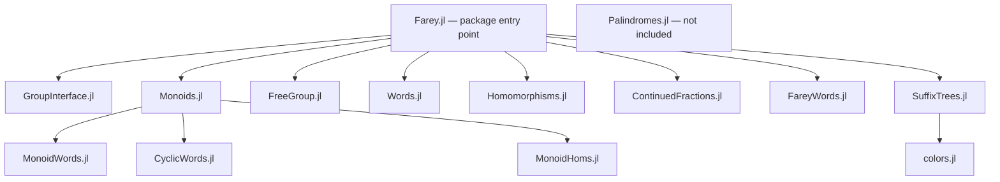

# Codebase map

Initial inventory: 2026-10-12. This describes the checked-in implementation,
not a promise that every method is supported or verified.

Cleanup direction established after this inventory: FreeGroup is outdated;
Monoids is the preferred implementation. Migrate its consumers and remove
KnuthBendix and GroupsCore. See the [cleanup tracker](cleanup-tracker.md) for
the dependency inventory and ordered migration tasks.
That tracker also records inherited GroupsCore defaults, planned ownership
in GroupInterface, and usage from `../farey-testing/working_setup.jl`.

The Julia package is named `Farey`. Its entry point is `src/Farey.jl`.
There are 14 source files (2,523 lines including comments and blank lines),
two example scripts, and four test assertions, all about continued fractions.

## Loading structure

These arrows represent `include` relationships. Loading order matters:
interfaces and monoid types are available before the higher-level algorithms.

## Modules and responsibilities

| File | Responsibility and main names | Connections |
| --- | --- | --- |
| `src/Farey.jl` | Root module, imports, exports, shared operators for inversion, division and conjugation | Loads all active components |
| `src/GroupInterface.jl` | `Interfaces` module; abstract groups, monoids, elements and homomorphisms | Extends GroupsCore types |
| `src/Monoids.jl` | `Monoids` submodule and its loading boundary | Groups the next three files |
| `src/MonoidWords.jl` | `FreeGen`, `MonoidWord`, `FreeWord`; word reduction, products, powers, iteration, indexing, representation, common prefixes and parsing via `element` | Custom word representation; UnicodeFun for display |
| `src/CyclicWords.jl` | `CyclicGen`, finite-order generator arithmetic and conversions | Builds on custom monoid types |
| `src/MonoidHoms.jl` | `Monoids.MonoidHom`; generator substitution, composition and powers | Operates on custom monoid words |
| `src/FreeGroup.jl` | `FreeGroup`, `FreeGroupElement`; construction, reduced words, arithmetic and `pretty_rep` | Uses KnuthBendix rewriting/FPMonoids and GroupsCore |
| `src/Words.jl` | `word`, cyclic shift `<<`, `conj_prefix` | Bridges group and monoid element operations |
| `src/Homomorphisms.jl` | `Hom`; free-group generator maps, application, composition, powers and conjugation | Uses FreeGroup and KnuthBendix words; also contains placeholder types |
| `src/ContinuedFractions.jl` | `ContinuedFraction`, `CF`, `@cf`, `@cf0`, conversions, normalization, arithmetic, `⊕`, `⊖`, `farey_neighbours` | Rational-number foundation for word construction |
| `src/FareyWords.jl` | `christoffel`, `s_seq`, `farey_word`, `palindrome`, `shrink_cf`, unexported `σ` | Combines continued fractions, word arithmetic and homomorphisms |
| `src/SuffixTrees.jl` | `SuffixTrees` submodule, exposed as `Farey.SFX`; tree construction, navigation, suffix/subword inspection, text display and DOT export | Handles strings and word elements; uses AbstractTrees and FixedSizeArrays |
| `src/colors.jl` | `TEXTCOLORS`, `COLORS` | Both used by suffix-tree DOT export |
| `src/Palindromes.jl` | Unloaded `Palindromes` module; palindrome, prefix/suffix and closure experiments | `Pal` contains unfinished assignment and unresolved names |

There are two word representations: `FreeGroupElement` wraps a KnuthBendix
word with a parent group, while `Monoids` implements its own generators and
words. Document their distinct purposes and conversion boundaries before
performing consolidation onto Monoids. Likewise, `Farey.Hom` and
`Farey.Monoids.MonoidHom` have different contracts to address during migration.

## User-facing entry points

`using Farey` exports continued-fraction and Farey-word functions, `FreeGroup`,
`Hom`, common word operators, and module aliases `Monoids` and `SFX`.
`KB`, `MON`, `GPC` and `ITR` are also exported dependency aliases.
Custom generators and homomorphisms live under `Farey.Monoids`; suffix-tree
functions are accessed through `Farey.SFX`. Some internal types are imported
into the root module without being exported.

The main mathematical flow is:

1. Represent a rational as a `ContinuedFraction`, normalize and manipulate it.
2. Supply generators from a free group or custom monoid representation.
3. Construct Christoffel words; `s_seq` uses a squared Christoffel word to
   extract exponents, and `farey_word` combines alternating palindrome blocks.
4. Apply homomorphisms or inspect words with suffix trees as needed.

`s_seq` explicitly limits input to rationals between 0 and 1 inclusive.
Its current zero case returns `[2]`. Negative homomorphism powers are not
implemented. These conventions need explicit documentation and tests.

## Supporting files and validation

| Path | Role / current state |
| --- | --- |
| `Project.toml` | Package identity, dependencies, compatibility and Test target |
| `README.md` | Brief setup pointer and three functionality descriptions; omits monoid and suffix-tree components |
| `examples/continued_fractions_ex.jl` | Continued fractions, macros, arithmetic and Farey operations |
| `examples/free_group_ex.jl` | Group constructors, homomorphisms, Christoffel/Farey words and S-sequences |
| `test/runtests.jl`, `test/continuedfractiontest.jl` | Four assertions covering construction, rational conversion and equality |
| `.github/workflows/CI.yml` | Julia 1.10, 1.12 and prerelease jobs on Linux |
| `Settings.toml` | Display settings; no reader found in checked-in source |
| `Farey/Project.toml`, `Farey/Manifest.toml` | Nested Julia environment; project has an empty dependency table; purpose needs clarification |
| `change.log` | Empty file |

Baseline check: `julia --project=. -e 'using Farey; include("test/runtests.jl")'`
passed all four assertions on installed Julia 1.13.1. This does not verify
the other algorithms, example scripts, clean dependency installation, or the
minimum supported Julia version. No API docstrings were found in source;
existing triple-quoted strings are display/DOT templates or commented code.

## Cleanup candidates, with evidence

Repository searches can establish local references, but cannot establish that
an unexported function is unused in external thesis scripts or notebooks.

| Candidate | Evidence | Proposed handling |
| --- | --- | --- |
| `Palindromes.jl` | No include/reference from active code; unfinished `Pal` implementation | Decide whether to preserve as research material, finish it, or remove it |
| Root `GroupHom`, `MonoidHom`, `AnyHom` placeholders | Only declarations found in `Homomorphisms.jl`; actual monoid homomorphism lives in another namespace | Review external usage, then remove if obsolete |
| `σ` | Defined in `FareyWords.jl`, not exported, no local caller found | Determine its mathematical role before documenting or retiring |
| Automa dependency | No source, test or example references found | Verify clean loading after removal in a separate cleanup change |
| IJulia, RemoteREPL, Revise dependencies | No references found in source, tests or examples | Consider moving to a development environment |
| Match and TOML imports/dependencies | Imported in root module; no uses found | Remove imports and dependencies together after verification |
| `Settings.toml` | No configuration loading found; display code has constants such as `SEP` | Decide whether configuration is intended or obsolete |
| Nested `Farey/` environment | Empty project dependency table; not used by current test entry point | Establish provenance before removal |
| `DOT` constant | Only its declaration found | Check external qualified access before removal |
| Commented implementations | Large obsolete-looking blocks in suffix trees and smaller blocks elsewhere | Review for unique research context; preserve useful explanations before deleting code |

Retain `colors.jl`: it is loaded and both palettes have active callers.
AbstractTrees, FixedSizeArrays and UnicodeFun have active implementation
references. GroupsCore and KnuthBendix also have active references, but are
scheduled for removal through the migration in the cleanup tracker.

## Correctness questions to settle before documenting guarantees

- `Hom` has a disabled domain check and an explicit TODO about composition
  compatibility. Test composition direction and maps between distinct groups.
- Group multiplication converts the right operand through the left operand's
  monoid, while equality checks parent identity. Establish intended behavior
  for operands from different groups.
- Verify continued-fraction macros in nested expressions; the example script
  already warns about macro expansion.
- Establish supported suffix-tree symbol ranges, terminal-symbol behavior and
  string indexing: the implementation uses a fixed alphabet size of 510.
- Verify zero, negative and infinite rational conventions, negative
  denominators, and boundary cases of Farey neighbours and word construction.

These are review targets inferred from source, not confirmed bug reports.
